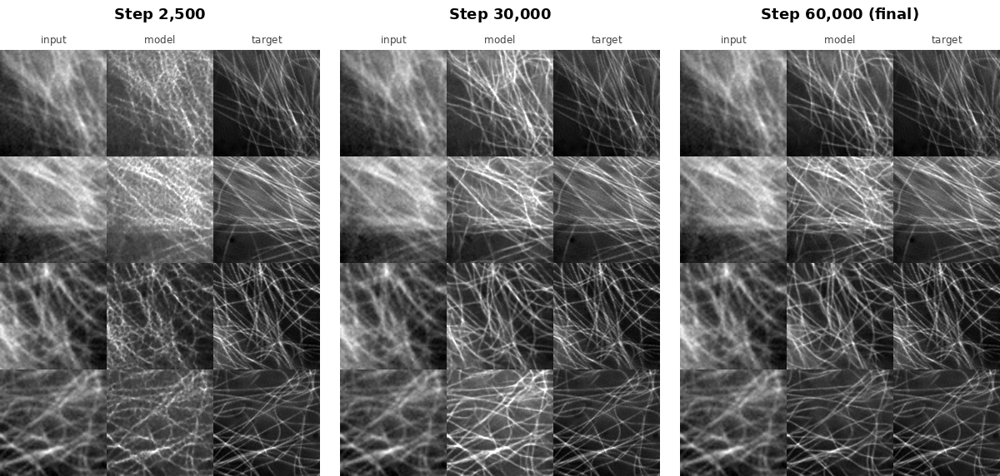

# SR3 Diffusion Super-Resolution for Fluorescence Microscopy

I'm using a diffusion model (SR3) to turn blurry, noisy microscope images into sharp, high-resolution ones. The bigger goal is fast (video-rate) fluorescence microscopy: capture quick low-quality frames, then let a model fill in the detail. The paper this builds on used a GAN for that. I'm trying it with diffusion instead.

## Results so far

Each picture has three columns: the **input** (blurry widefield image), what the **model** made, and the **target** (the real high-res SIM image). The input and target come from the dataset. Only the middle column is generated by the model. These are validation images the model never trained on.



- **Step 2,500:** the model is just starting. It adds a messy, web-like texture and doesn't know what filaments look like yet.
- **Step 30,000:** the filaments are sharp and mostly in the right places. Some spots are too bright or have extra lines.
- **Step 60,000:** the closest match to the target. Cleaner background, thinner lines.

Things I still want to fix: the background is a little hazier than the target in some images, and in really crowded areas the model sometimes draws lines that aren't in the real image.

Test-set numbers (PSNR / SSIM at different noise levels) are coming next.

## Dataset

[BioSR](https://github.com/DeepTrackAI/biosr_dataset), microtubules only.

- Pairs of widefield (input) and SIM (target) images, 128x128
- 41,040 training pairs, 2,160 validation pairs
- 150 test images at 9 noise levels (level 1 = noisiest, level 9 = cleanest)

The dataset is about 6 GB, so it's not in this repo. The notebook downloads it.

## How it works (short version)

1. Take a sharp target image and add random noise to it.
2. Show the model the noisy image plus the blurry input, and train it to guess the noise.
3. To make a new image, start from pure noise and remove a little noise at a time (50 steps), always looking at the blurry input.

The model is a U-Net. It sees the blurry input stacked on top of the noisy image, plus a number telling it how noisy things are.

## Training setup

| | |
| --- | --- |
| GPU | Google Colab, free T4 |
| Model size | about 15.5M parameters |
| Training steps | 60,000 (batch size 16) |
| Speed | about 4 steps per second, so roughly 4 hours |
| Sampling | 50 steps per image |

## How to run it

The easiest way is the notebook: open `SR3_BioSR_colab.ipynb` in Google Colab, switch to a T4 GPU, and run the cells top to bottom. It downloads the data, trains, saves checkpoints to Google Drive, and makes the comparison images.

To run it on your own GPU:

```bash
pip install -r requirements.txt
git clone --depth 1 https://github.com/DeepTrackAI/biosr_dataset
python train.py --config configs/biosr.json
python evaluate.py --ckpt runs/biosr/last.pt --steps 50 --beta_end 0.1 \
  --hr_dir biosr_dataset/BioSR/Microtubules/test_gt \
  --lr_dir biosr_dataset/BioSR/Microtubules/test_wf/level_01
```

## Files

| File | What it does |
| --- | --- |
| `SR3_BioSR_colab.ipynb` | Full pipeline in Colab |
| `train.py` | Trains the model |
| `evaluate.py` | Compares the model to the input (PSNR, SSIM) and saves preview images |
| `sample.py` | Runs the trained model on new images or whole video stacks |
| `tune_schedule.py` | Tries different sampling settings to find the best one |
| `model.py` | The U-Net |
| `diffusion.py` | Adding noise, the training loss and the sampling loop |
| `dataset.py` | Loads and prepares the images |
| `config.py`, `configs/` | All the settings |
| `make_synthetic.py` | Makes fake test images to check everything runs |

See [NOTES.md](NOTES.md) for more on what I changed and what's next.
